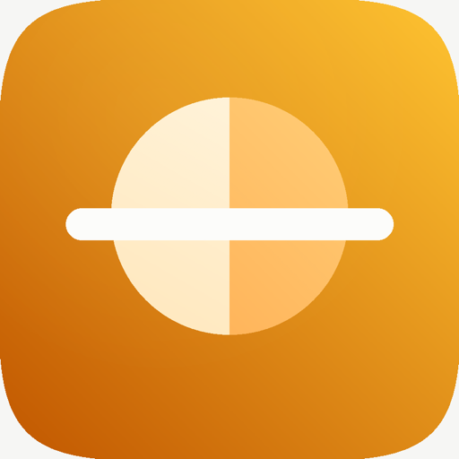
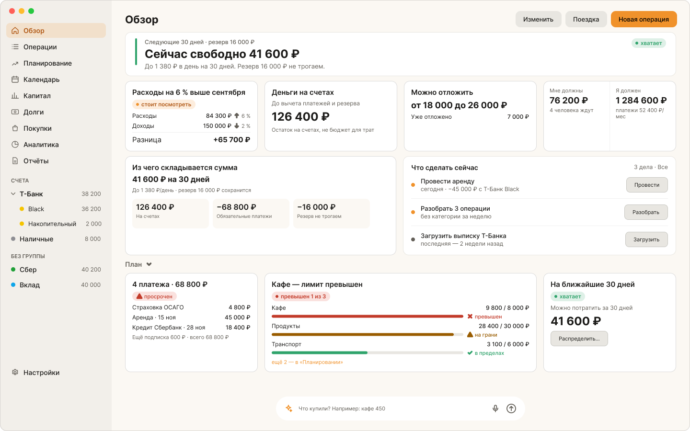
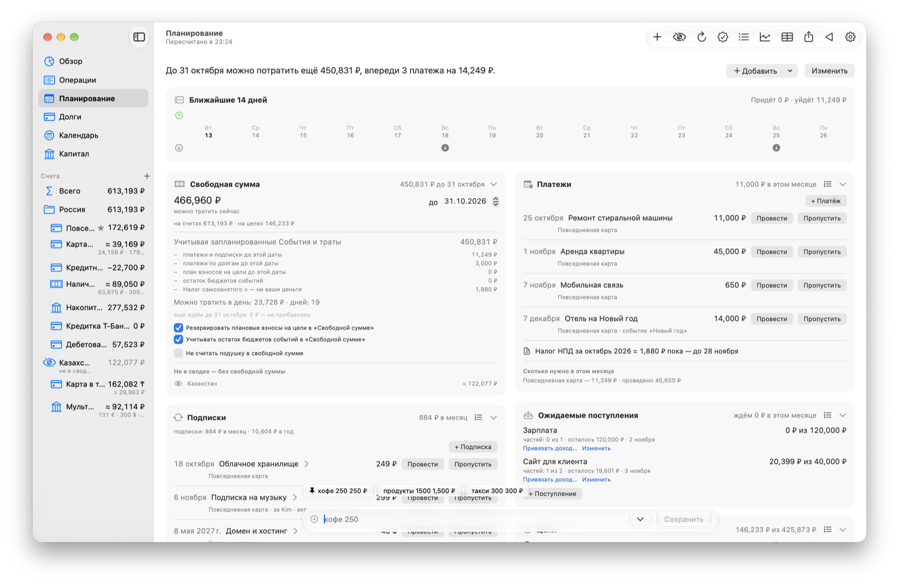
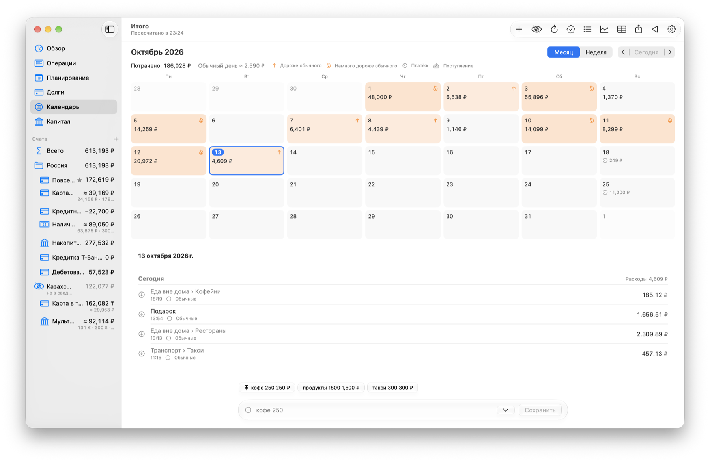
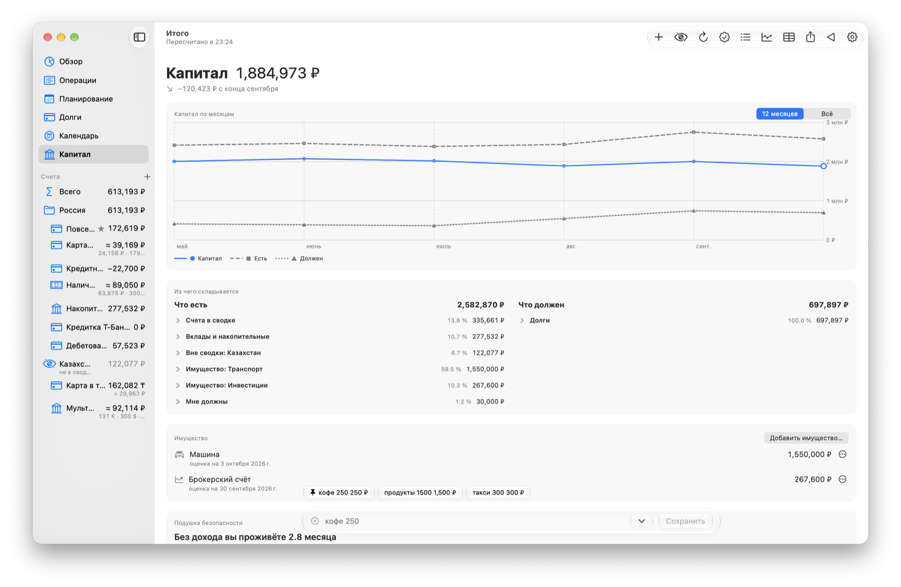
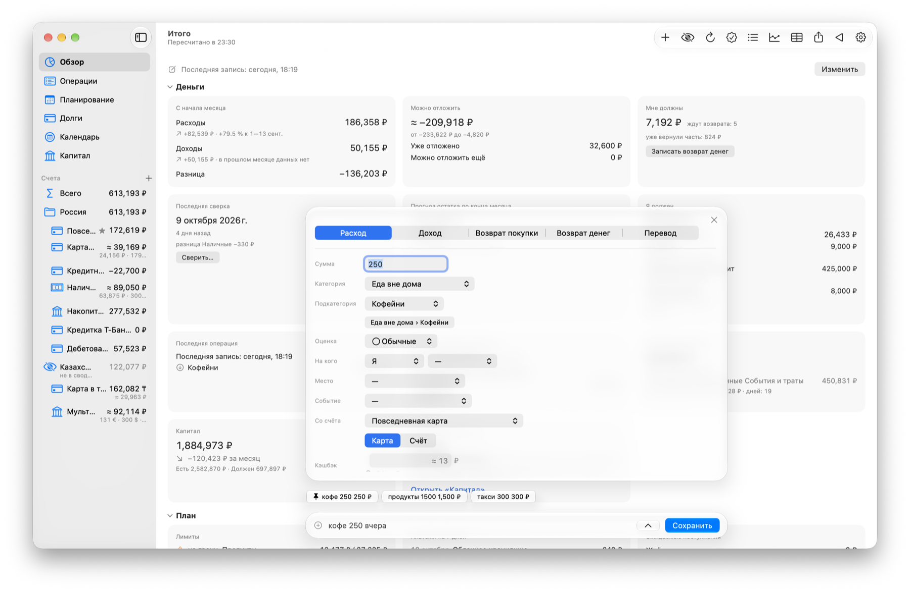

  

<h1 align="center">OhMyMoney</h1>

  Учёт личных финансов для Mac, iPhone и iPad. 
  Пишете одну строку — <code>кофе 250</code> — и видите, сколько можно потратить до конца месяца.

  <a href="https://github.com/EvgenyBaulin/ohmymoney/releases/latest"><b>Скачать для Mac</b></a> ·
  <a href="https://ohmymoney.ru">ohmymoney.ru</a> ·
  <a href="guide/features.md">Все возможности</a> ·
  <a href="CHANGELOG.md">Что нового</a>

  
  

<picture>
  <source media="(prefers-color-scheme: dark)" srcset="guide/screenshots/overview-dark.png">
  
</picture>

## Что умеет

- **Запись одной строкой** — по-русски или по-английски: `такси 350`, `обед (1200+800)/2`, `+ зарплата 120k`.
- **Свободные деньги** — деньги на счетах минус ближайшие платежи, кредиты и отложенное на цели; у каждой цифры есть расчёт по строкам.
- **Планирование и долги** — платежи (в том числе оплаченные по частям), подписки, лимиты, цели, челленджи, кредиты, рассрочки.
- **Банки, карты и кэшбэк** — банк со счетами и картами; кредитка — отдельная карта банка со своими условиями и льготным периодом; условия вкладов; советник по кэшбэку.
- **Покупки, чеки и «Итоги»** — список желаний, вещи, фото чеков и гарантии, итоги недели, месяца и года.
- **Налоги и квартира** — налоговые вычеты, счётчики и квитанции за коммунальные услуги.
- **Капитал** — счета, имущество и долги по месяцам, в том числе до начала учёта.
- **Быстрый старт** — перенос из CoinKeeper, Дзен-мани, Money Manager, Excel и CSV; сообщения банка через Быстрые команды становятся операциями.
- **Mac, iPhone и iPad** — одни и те же экраны; у каждого устройства своя база, изменения ходят зашифрованными файлами через выбранную вами папку (например, iCloud Drive).
- **24 языка интерфейса** и размер текста «Как в системе» на iPhone и iPad.
- **Аналитика и отчёты** — по категориям, месяцам, людям и местам; выгрузка в CSV; отчёт для другого человека — PDF с паролем, который можно посмотреть до отправки.

Подробно — [все возможности](guide/features.md).

## Как выглядит

Все окна — на вымышленных данных демо-набора.

<table>
  <tr>
    <td width="50%">
      <picture>
        <source media="(prefers-color-scheme: dark)" srcset="guide/screenshots/planning-dark.png">
        
      </picture>
      
Планирование

    </td>
    <td width="50%">
      <picture>
        <source media="(prefers-color-scheme: dark)" srcset="guide/screenshots/calendar-dark.png">
        
      </picture>
      
Календарь

    </td>
  </tr>
  <tr>
    <td width="50%">
      <picture>
        <source media="(prefers-color-scheme: dark)" srcset="guide/screenshots/capital-dark.png">
        
      </picture>
      
Капитал

    </td>
    <td width="50%">
      <picture>
        <source media="(prefers-color-scheme: dark)" srcset="guide/screenshots/entry-dark.png">
        
      </picture>
      
Строка ввода

    </td>
  </tr>
</table>

## Приватность

- **Без аккаунта и сервера.** База лежит на вашем устройстве; в сеть приложение ходит только за курсами валют и обновлениями, а также туда, куда вы сами его подключите, — [список адресов](guide/privacy.md).
- **Без слежки.** Ни аналитики, ни рекламы, ни сторонних SDK; в журнале ошибок нет сумм и названий.
- **Скрыть суммы и счета.** ⌃⌘H прячет все суммы, отдельный счёт можно скрыть, вход — по Touch ID или паролю.
- **Копии.** Бэкап после каждого изменения, копия дня и архив с паролем для переезда на другой Mac.

## Как установить

Готовый выпуск — для Mac. Версии для iPhone и iPad собираются из тех же исходников; готового файла для них в выпусках нет.

1. Нужна macOS 26 (Tahoe) или новее.
2. Скачайте `OhMyMoney-<версия>.zip` из [последнего выпуска](https://github.com/EvgenyBaulin/ohmymoney/releases/latest).
3. Распакуйте и перенесите `OhMyMoney.app` в **Программы**.
4. При первом запуске macOS его заблокирует: откройте **Системные настройки → Конфиденциальность и
   безопасность** и нажмите **Всё равно открыть**. Это нужно один раз.

Новые версии приходят сами: приложение предложит обновиться. Подробно — [установка и первый запуск](guide/install.md).

## Подробнее

| Если хотите узнать… | Читайте |
|---|---|
| что умеет приложение | [Возможности](guide/features.md) |
| как установить и что будет при первом запуске | [Установка](guide/install.md) |
| как приходят обновления и что меняется при переходе на новую версию | [Обновления](guide/updates.md) |
| куда ходит приложение в сеть и что оно о вас знает | [Приватность](guide/privacy.md) |
| где лежат данные, как сделать копию, выгрузить или перенести на другой Mac | [Ваши данные](guide/data.md) |
| как устроены файлы выгрузки и архива переноса | [Форматы данных](guide/formats.md) |
| какие таблицы и столбцы в файле базы | [Формат базы](guide/database.md) |
| как собрать из исходников и выпустить версию | [Для разработчика](guide/development.md) |
| что изменилось в каждой версии | [CHANGELOG](CHANGELOG.md) |

## Благодарности

- [GRDB.swift](https://github.com/groue/GRDB.swift), автор — Gwendal Roué, лицензия MIT.
- [Sparkle](https://github.com/sparkle-project/Sparkle) — лицензия MIT.

## Лицензия

[MIT](LICENSE) © 2026 Evgeny Baulin
