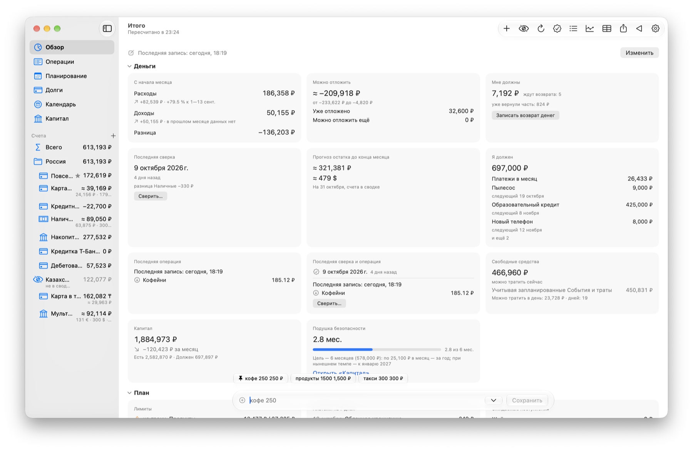
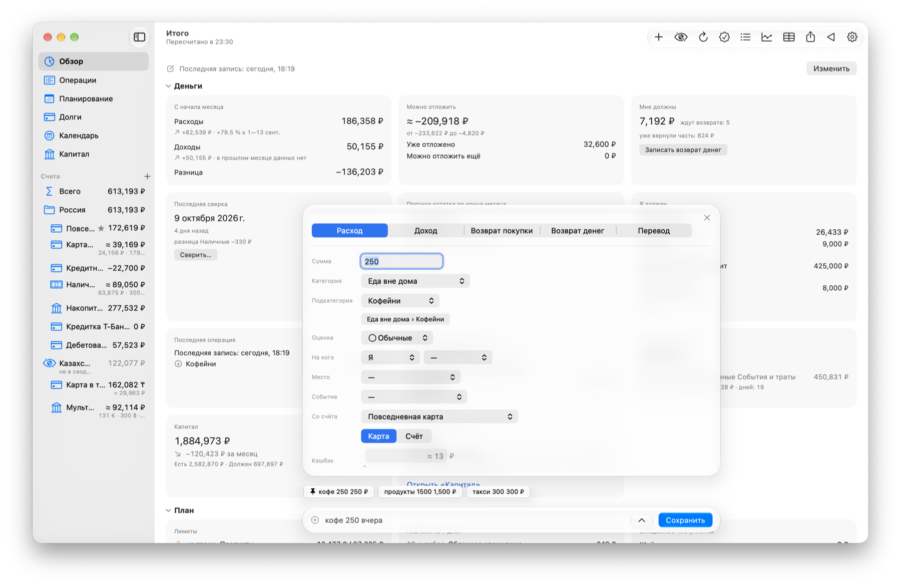
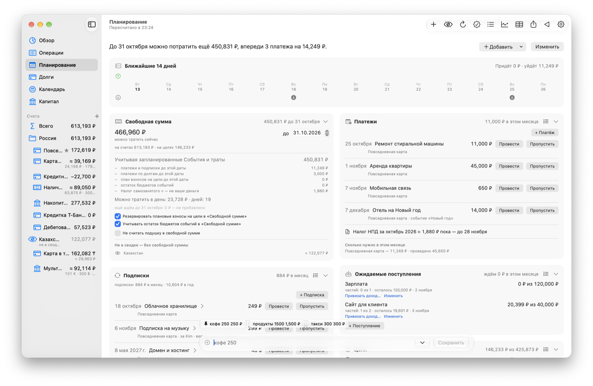

# OhMyMoney

**OhMyMoney** — приложение для учёта личных финансов на Mac. Пишете одну строку — `кофе 250` — и получаете
учёт, план и отчёты. Все данные остаются на вашем Mac.

## Что умеет

- **Запись одной строкой** — на русском или английском: `такси 350`, `обед (1200+800)/2`.
- **Счета и карты** — в разных валютах, с кэшбэком и остатками.
- **Планирование** — платежи, подписки, лимиты, цели и сколько можно потратить сейчас.
- **Долги** — кто сколько должен вам и вы кому.
- **Аналитика и отчёты** — по категориям, месяцам, людям и местам, с выгрузкой в CSV.
- **Без сети и слежки** — в интернет только за курсами Банка России и обновлениями; телеметрии нет.

Подробно — [все возможности](guide/features.md).

## Как выглядит

Окна показаны на вымышленных данных демо-набора.

<picture>
  <source media="(prefers-color-scheme: dark)" srcset="guide/screenshots/overview-dark.png">
  
</picture>

<picture>
  <source media="(prefers-color-scheme: dark)" srcset="guide/screenshots/entry-dark.png">
  
</picture>

<picture>
  <source media="(prefers-color-scheme: dark)" srcset="guide/screenshots/planning-dark.png">
  
</picture>

## Как установить

1. Нужна macOS 26 (Tahoe) или новее.
2. Скачайте `OhMyMoney-<версия>.zip` из [последнего выпуска](https://github.com/EvgenyBaulin/ohmymoney/releases/latest).
3. Распакуйте и перенесите `OhMyMoney.app` в **Программы**.
4. При первом запуске macOS его заблокирует: откройте **Системные настройки → Конфиденциальность и
   безопасность** и нажмите **Всё равно открыть**. Это нужно один раз.

Подробно — [установка и первый запуск](guide/install.md).

Новые версии приходят сами: приложение предложит обновиться.

## Подробнее

| Если хотите узнать… | Читайте |
|---|---|
| что умеет приложение | [Возможности](guide/features.md) |
| как установить и что будет при первом запуске | [Установка](guide/install.md) |
| как приходят обновления и что меняется при переходе на новую версию | [Обновления](guide/updates.md) |
| куда ходит приложение в сеть и что оно о вас знает | [Приватность](guide/privacy.md) |
| где лежат данные, как сделать копию, выгрузить или перенести на другой Mac | [Ваши данные](guide/data.md) |
| как устроены файлы выгрузки и архива переноса | [Форматы данных](guide/formats.md) |
| какие таблицы и столбцы в файле базы | [Формат базы](guide/database.md) |
| как собрать из исходников и выпустить версию | [Для разработчика](guide/development.md) |
| что изменилось в каждой версии | [CHANGELOG](CHANGELOG.md) |

## Благодарности

- [GRDB.swift](https://github.com/groue/GRDB.swift), автор — Gwendal Roué, лицензия MIT.
- [Sparkle](https://github.com/sparkle-project/Sparkle) — лицензия MIT.

## Лицензия

[MIT](LICENSE) © 2026 Evgeny Baulin
